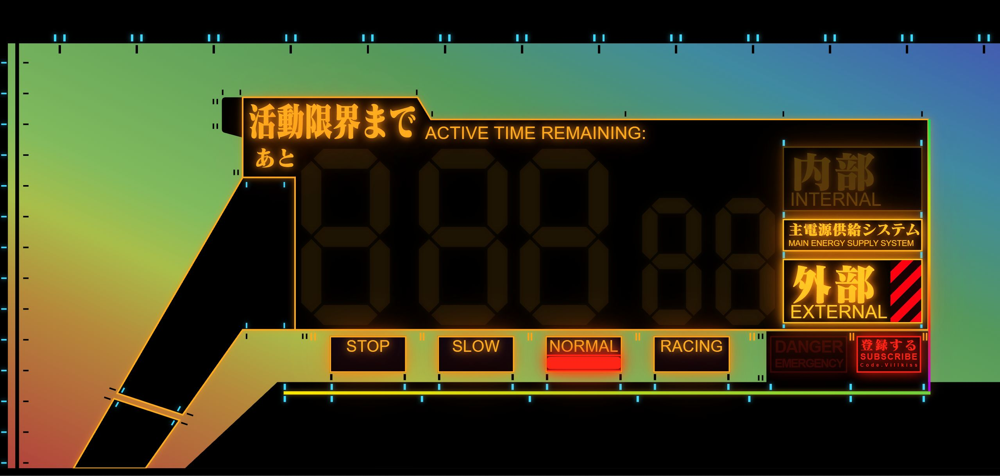
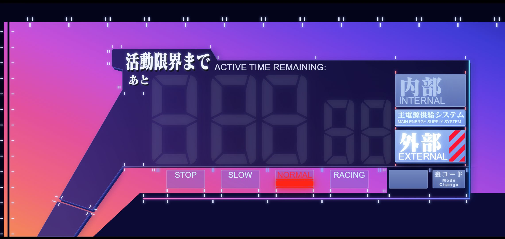

#  EVA-UI-Pannel

**ACTIVE TIME REMAINING — Front View**

🌐 [中文说明](./README.md)

An Evangelion-inspired armored HUD countdown / clock. Pure HTML + CSS + inline SVG, with Canvas for the glitch effects — zero build step, just open the file.




---

## ✨ Features

- **Two themes — EOE / ROE** — EOE follows the TV series, ROE follows the Rebuild films. Toggle from the diagonal notch at the bottom-left
- **Auto red / blue filters** — the final 7 seconds and "The Beast" share one red filter; Reserve and zero-state can switch to the blue filter (`F`). Precedence lives in the selectors (base < red < blue), never in source order
- **Charging armor background** — pitch black when off; sweeps in from bottom-left to top-right on power-on via `mask-image` translation
- **Five power states** — OFF / External / Reserve / Internal / Zero
- **Three views** — countdown `5:00.00` (centisecond precision), 24H clock, 12H clock
- **Self-check + scramble boot** — powering up in External lights STOP → SLOW → NORMAL in sequence; entering Internal scrambles the digits, freezes on `5:00.00`, then starts counting
- **Danger / zero states** — turns blood-red and blinks for the final 7 seconds; on zero the STOP bar locks and the title and DANGER box blink on independent rhythms
- **The Beast (獣化)** — in ROE while powered, click「裏コード」to tear the titles, hollow the digits and throw 8px color blocks; `Esc` exits
- **Full keyboard accessible** — Tab to focus, Enter / Space to activate, `F` for the blue filter, `Esc` to leave The Beast

## 📁 Structure

```
.
├── README.md / README.en.md
├── image/
│   ├── EOE.jpg
│   └── ROE.jpg
└── src/
    ├── 活動限界まで.html            # single self-contained entry point
    └── font/
        └── EVA-Matisse_Classic.ttf  # title font (place it yourself)
```

## 🚀 Quick Start

```bash
git clone https://gitee.com/AmadeusC204/eva-ui-pannel.git
cd eva-ui-pannel/src
ls font/EVA-Matisse_Classic.ttf   # make sure the font is in place
open 活動限界まで.html            # double-click to run
```

Or use a static server (more reliable font loading):

```bash
python3 -m http.server 8080
# open http://localhost:8080/活動限界まで.html
```

## 🎮 Usage

| Action | Effect |
|---|---|
| Click `主電源供給システム` | Toggle main power. Powering up resets to External + countdown and runs the self-check |
| Click `内部` | Enter Internal: scramble → freeze `5:00.00` → count down. Clicking again at zero restarts |
| Click `外部` | From Internal, drop back to External standby; from External, switch to `予備 / AUXILIARY` (white hatching, all function bars dark, blue filter on by default) |
| Click the small block left of the title | Cycle: countdown → 24H → 12H (leaving Reserve when switching to clock) |
| Click the bottom-left notch | EOE ⇄ ROE palette |
| Click `STOP / SLOW / NORMAL / RACING` | Manually override the gear indicator (External defaults to NORMAL, Internal to RACING, zero locks STOP) |
| Click `裏コード / 登録する` | Toggle The Beast (ROE + powered only) |
| `Ctrl` / `⌘` / `Shift` + click the same box | Open the reference video (bilibili) |
| `F` | Blue filter on/off — only in Reserve and Internal-zero |
| `Esc` | Leave The Beast |
| Tab / Enter / Space | Full keyboard control |

> While powered off, the digits, mode boxes, buttons and DANGER box all hide — only the black armor silhouette stays. The ROE bottom-left notch still glows; that is intended.

## 🧠 State Machine

The JS keeps a few source states; `render()` → `syncBody()` turns them into classes on `<body>`, and the CSS only reads those classes:

```js
mode      // MODE_OFF / MODE_EXTERNAL / MODE_RESERVE / MODE_INTERNAL / MODE_ZERO
viewMode  // VIEW_COUNTDOWN / VIEW_CLOCK_24 / VIEW_CLOCK_12
roe       // palette: true = ROE, false = EOE
beast     // The Beast (only valid in ROE while powered)
barOverride            // manual gear index, null = follow state
blueOpt{reserve,zero}  // blue-skin switches per scenario (F key)
```

| class | Meaning | Triggered by |
|---|---|---|
| `pw` | Main power on: charge animation + UI fades in | power box click |
| `clk` | Clock view (hides countdown, shows HH:MM:SS) | title-block click |
| `roe` | ROE palette | bottom-left notch click |
| `reserve` | Reserve supply | second click on External |
| `danger` | Final 7 s: red blink | countdown ≤ 7000 ms |
| `zero` | Limit reached | countdown = 0 |
| `blue` | Blue filter active | Reserve by default / `F` at zero |
| `beast` | The Beast | 「裏コード」click |

There is also `body.dataset.mode = 'internal' | 'external'` for the two label sets.

To jump straight to a state, paste one line into the console:

| Target | Code |
|---|---|
| Power on (External standby) | `document.body.classList.add('pw')` |
| Power off | `document.body.classList.remove('pw')` |
| Clock view | `document.body.classList.add('clk')` |
| Back to countdown | `document.body.classList.remove('clk')` |
| Danger red | `document.body.classList.add('danger')` |
| Zero | `document.body.classList.add('pw','zero')` |
| Reserve | `document.body.classList.add('pw','reserve')` |
| ROE palette | `document.body.classList.add('roe')` |
| Back to EOE | `document.body.classList.remove('roe','beast','blue')` |
| Blue filter | `document.body.classList.add('roe','blue')` |
| The Beast | `document.body.classList.add('roe','beast')` |
| Leave The Beast | `document.body.classList.remove('beast')` |

These switch the look only; they do not drive the timer.

## 🔤 Font

The title uses **EVA Matisse Classic** (self-hosted via `@font-face`). It is a closed commercial font, so **it is NOT included in this repo**:

- Drop `EVA-Matisse_Classic.ttf` into `src/font/` yourself
- Missing? The browser falls back to `serif` — layout stays intact, but you lose the EVA glyph flavor

## 🎨 Customization

### Sizing

```css
:root{
  --stageW:1300px; --stageH:600px;  /* visible stage */
  --bleed:200px;                    /* 200px extra on the left of the stage: hatches and the notch live there */
}
```

`fitPanel()` scales the whole panel to fit the window, so these numbers are safe to edit.

### Colors

```css
body{
  --amber:#ffac1e;   /* EOE primary */
  --red:#ff2415;     /* danger red */
  --cyan:#3fd8ff;    /* ticks / separator base */
}
```

ROE does not use those three; its palette is a set of slots in chapter 17, `body.roe{…}`:

| Slot | Controls |
|---|---|
| `--plateTop / --plateMid / --plateBot` | panel glass, three stops of the `#gPanel` gradient |
| `--plateD0 … --plateD3` | armor brightness, four levels (D0 darkest): walls, shadows, seam patches |
| `--plateRim` | inner stroke / seam line |
| `--boxBg / --btnOnBg / --powerOnBg / --btnOffBg` | mode boxes and power key fills |
| `--gradbarBg / --glineBg` | divider bars |
| `--titleC / --titleEnC` | the two title colors |

### Behavior constants (top of the JS)

| Constant | Purpose | Default |
|---|---|---|
| `DURATION_MS` | one round | 5 minutes |
| `DANGER_AT_MS` | danger threshold | 7000 |
| `SEG_LIGHT_MS` / `SCRAMBLE_MS` / `SCRAMBLE_HOLD` / `HOLD_MS` | boot scramble and freeze timing | 100 / 200 / 75 / 600 |
| `BOOT_OFF_MS` / `BOOT_DROP_MS` | digit blackout moments on power-up / internal start | 200 / 260 |
| `ROE_GAP_SCALE` | ROE segment-gap multiplier | 1.5 |

### Style chapters

```
01–16  shared base for EOE / ROE
17     ROE palette layer (body.roe)
18     ROE 3D geometry and buttons
19     red skin (shared by beast / danger)
19a    Beast motion and glitch
20     blue filter (body.roe.blue)
```

> Filter precedence is not source order: every red rule carries `:where(:not(.blue))`, so the whole chapter stops matching while the blue filter is on. Follow that pattern for new red rules.

## 📄 License

Interface code: MIT © 2026.

`EVA-Matisse_Classic.ttf` is the property of its original author / publisher. Do not redistribute it with this repo; make sure you have a valid license before using it.

---

> *「活動限界まで — あと 5:00.00」*
