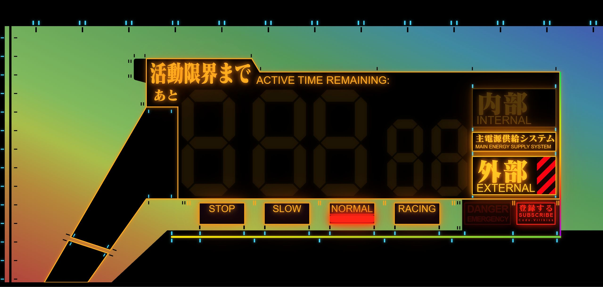
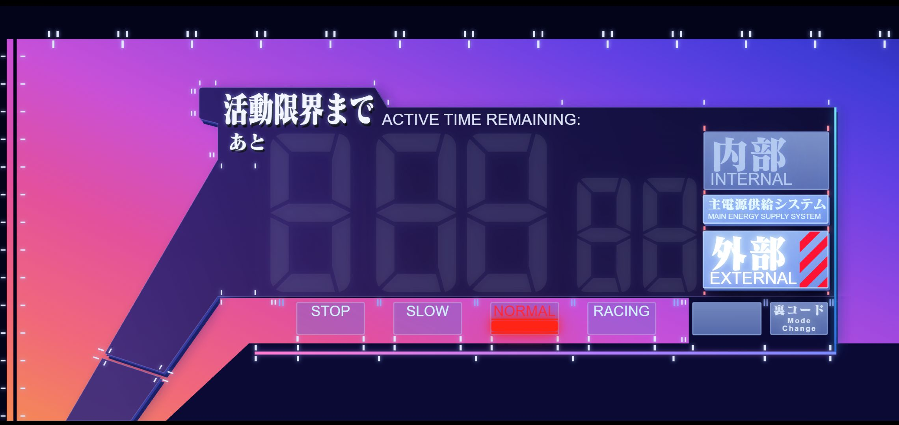

#  EVA-UI-Pannel

**ACTIVE TIME REMAINING — 正面视图**

🌐 **[English version](./README.en.md)**

EVA 风格的装甲风 HUD 倒计时／时钟界面。纯 HTML + CSS + 内联 SVG，獣化特效走 Canvas，无需构建、双击即开。




---

## ✨ 特性

- **双主题 EOE / ROE**：EOE 是黑红平贴，ROE 是蓝玻璃立体按键 + 粉紫渐变背景，点左下角斜槽切换
- **滤镜 红/蓝自动接管**：最后 7 秒与「獣化」共用一套红滤镜；予備与内部归零可开蓝滤镜（F 键）。优先级写在选择器里（基础 < 红 < 蓝），不依赖章节顺序
- **充电式装甲背景**：断电纯黑，通电后沿「左下 → 右上」扫掠充能显现
- **五种供电状态**：主電源 OFF ／ 外部 ／ 予備 ／ 内部 ／ 归零
- **三视图**：倒计时 `5:00.00`（厘秒）／ 24H 时钟 ／ 12H 时钟
- **开机自检 + 乱码启动**：外部通电时 STOP → SLOW → NORMAL 依次点亮；切内部先随机乱码，定格 `5:00.00` 再起跑
- **警戒 / 归零**：最后 7 秒整体切红闪烁；归零锁 STOP 红条，标题与 DANGER 框分组异步闪烁
- **獣化（The Beast）**：ROE 通电下点「裏コード」，标题撕裂、数码管镂空、8px 色块花屏同时上；Esc 退出
- **全键盘可操作**：Tab 聚焦、Enter / Space 触发、F 切蓝、Esc 退獣化

## 📁 文件结构

```
.
├── README.md / README.en.md
├── image/
│   ├── EOE.jpg
│   └── ROE.jpg
└── src/
    ├── 活動限界まで.html            # 唯一入口，单文件自包含
    └── font/
        └── EVA-Matisse_Classic.ttf  # 标题字体（需自行放入）
```

## 🚀 快速开始

```bash
git clone https://gitee.com/AmadeusC204/eva-ui-pannel.git
cd eva-ui-pannel/src
ls font/EVA-Matisse_Classic.ttf   # 确认字体已就位
open 活動限界まで.html            # 双击打开即可
```

想用静态服务器（字体加载更稳）：

```bash
python3 -m http.server 8080
# 访问 http://localhost:8080/活動限界まで.html
```

## 🎮 用法

| 操作 | 效果 |
|---|---|
| 点 `主電源供給システム` | 通電／断电。开机回初始态（外部 · 倒计时）并触发自检 |
| 点 `内部` | 进入内部供电：乱码 → 定格 `5:00.00` → 倒计时；归零时再点 = 重新开始 |
| 点 `外部`（内部中） | 退回外部待机 |
| 再点 `外部`（外部中） | 切到 `予備 / AUXILIARY`：选中块转白斜纹、功能条全灭、蓝滤镜默认开 |
| 点标题左侧小方块 | 循环：倒计时 → 24H → 12H（切时钟会退出予備） |
| 点左下角斜槽 | EOE ⇄ ROE 配色 |
| 点 `STOP / SLOW / NORMAL / RACING` | 手动覆盖档位指示（外部默认 NORMAL，内部默认 RACING，归零锁定 STOP） |
| 点 `裏コード / 登録する` | ROE + 通电下切换獣化 |
| `Ctrl` / `⌘` / `Shift` + 点同一个框 | 打开参考视频（B 站） |
| `F` | 蓝滤镜开／关（只在「予備」「内部归零」两个场景有效） |
| `Esc` | 退出獣化 |
| Tab / Enter / Space | 全功能键盘操作 |

> 断电时数码管、模式框、按钮、DANGER 框一律隐藏，只留黑色装甲轮廓；ROE 左下斜槽仍会亮，这是既定观感。

## 🧠 状态机

JS 只维护几个源头状态，`render()` → `syncBody()` 把它们算成 `<body>` 上的 class，CSS 只看类：

```js
mode      // MODE_OFF / MODE_EXTERNAL / MODE_RESERVE / MODE_INTERNAL / MODE_ZERO
viewMode  // VIEW_COUNTDOWN / VIEW_CLOCK_24 / VIEW_CLOCK_12
roe       // 配色：true = ROE，false = EOE
beast     // 獣化（只在 ROE + 通电下成立）
barOverride            // 功能条手动档位，null = 跟随状态
blueOpt{reserve,zero}  // 蓝滤镜在各场景的开关（F 键切）
```

| class | 含义 | 触发 |
|---|---|---|
| `pw` | 主电源接通，充能动画 + 全 UI 淡入 | 点主電源 |
| `clk` | 时钟视图（隐藏倒计时，显示 HH:MM:SS） | 点标题左侧方块 |
| `roe` | ROE 配色 | 点左下角斜槽 |
| `reserve` | 予備供电 | 外部再点一次 |
| `danger` | 最后 7 秒：切红闪烁 | 倒计时 ≤ 7000ms |
| `zero` | 活動限界到達 | 倒计时 = 0 |
| `blue` | 蓝滤镜生效 | 予備默认开 / 归零按 F |
| `beast` | 獣化 | 点「裏コード」 |

另有一个 `body.dataset.mode = 'internal' | 'external'`，给内部/外部两套文案用。

想直接切到某个状态，在控制台粘一行即可：

| 目标 | 代码 |
|---|---|
| 开机（外部待机） | `document.body.classList.add('pw')` |
| 断电 | `document.body.classList.remove('pw')` |
| 时钟视图 | `document.body.classList.add('clk')` |
| 回倒计时 | `document.body.classList.remove('clk')` |
| 告急红 | `document.body.classList.add('danger')` |
| 归零 | `document.body.classList.add('pw','zero')` |
| 予備 | `document.body.classList.add('pw','reserve')` |
| ROE 配色 | `document.body.classList.add('roe')` |
| 回 EOE | `document.body.classList.remove('roe','beast','blue')` |
| 蓝滤镜 | `document.body.classList.add('roe','blue')` |
| 獣化 | `document.body.classList.add('roe','beast')` |
| 退出獣化 | `document.body.classList.remove('beast')` |

只改外观，不驱动计时。

## 🔤 字体

标题用 **EVA Matisse Classic**（自托管 `@font-face`）。该字体为闭源商业字体，**仓库不含此文件**：

- 请自行把 `EVA-Matisse_Classic.ttf` 放进 `src/font/` 目录
- 缺失时回退到系统 `serif`，布局不崩但失去 EVA 字形味道

## 🎨 自定义

### 尺寸

```css
:root{
  --stageW:1300px; --stageH:600px;  /* 可见舞台 */
  --bleed:200px;                    /* 左侧出血，内部画布 = stageW + bleed */
}
```

JS 的 `fitPanel()` 按窗口等比缩放，改数值不用管缩放。

### 调色

```css
body{
  --amber:#ffac1e;   /* EOE 主色 */
  --red:#ff2415;     /* 警戒红 */
  --cyan:#3fd8ff;    /* 青线 / 刻度基准 */
}
```

ROE 的配色不走这三个，而是第 17 章 `body.roe{…}` 里的槽位：

| 槽位 | 管什么 |
|---|---|
| `--plateTop / --plateMid / --plateBot` | 面板玻璃三档（`#gPanel` 渐变） |
| `--plateD0 … --plateD3` | 装甲四档明度（D0 最暗）：侧壁、落影、补缝 |
| `--plateRim` | 内描边 / 补缝线 |
| `--boxBg / --btnOnBg / --powerOnBg / --btnOffBg` | 模式框与主電源底色 |
| `--gradbarBg / --glineBg` | 分界彩条 |
| `--titleC / --titleEnC` | 标题两档字色 |

### 行为常量（JS 顶部）

| 常量 | 作用 | 默认 |
|---|---|---|
| `DURATION_MS` | 一轮时长 | 5 分钟 |
| `DANGER_AT_MS` | 警戒阈值 | 7000 |
| `SEG_LIGHT_MS` / `SCRAMBLE_MS` / `SCRAMBLE_HOLD` / `HOLD_MS` | 开机乱码与定格节奏 | 100 / 200 / 75 / 600 |
| `BOOT_OFF_MS` / `BOOT_DROP_MS` | 开机/内部启动时数码管熄灭时刻 | 200 / 260 |
| `ROE_GAP_SCALE` | ROE 数码管段缝倍数 | 1.5 |

### 样式分区

```
01–16  EOE / ROE 共用的底座
17     ROE 配色层（body.roe）
18     ROE 立体与按钮
19     红滤镜（獣化 / 告急共用一套红）
19a    獣化动效与花屏
20     蓝滤镜（body.roe.blue）
```

> 皮肤优先级不靠源码顺序：红滤镜每条规则都带 `:where(:not(.blue))`，蓝滤镜在场即整节失效。新增红滤镜规则照这个格式写。

## 📄 许可

界面代码：MIT © 2026。

`EVA-Matisse_Classic.ttf` 版权归其原作者／发行方，请勿随仓库再分发，使用前请确保已获合法授权。

---

> *「活動限界まで — あと 5:00.00」*
